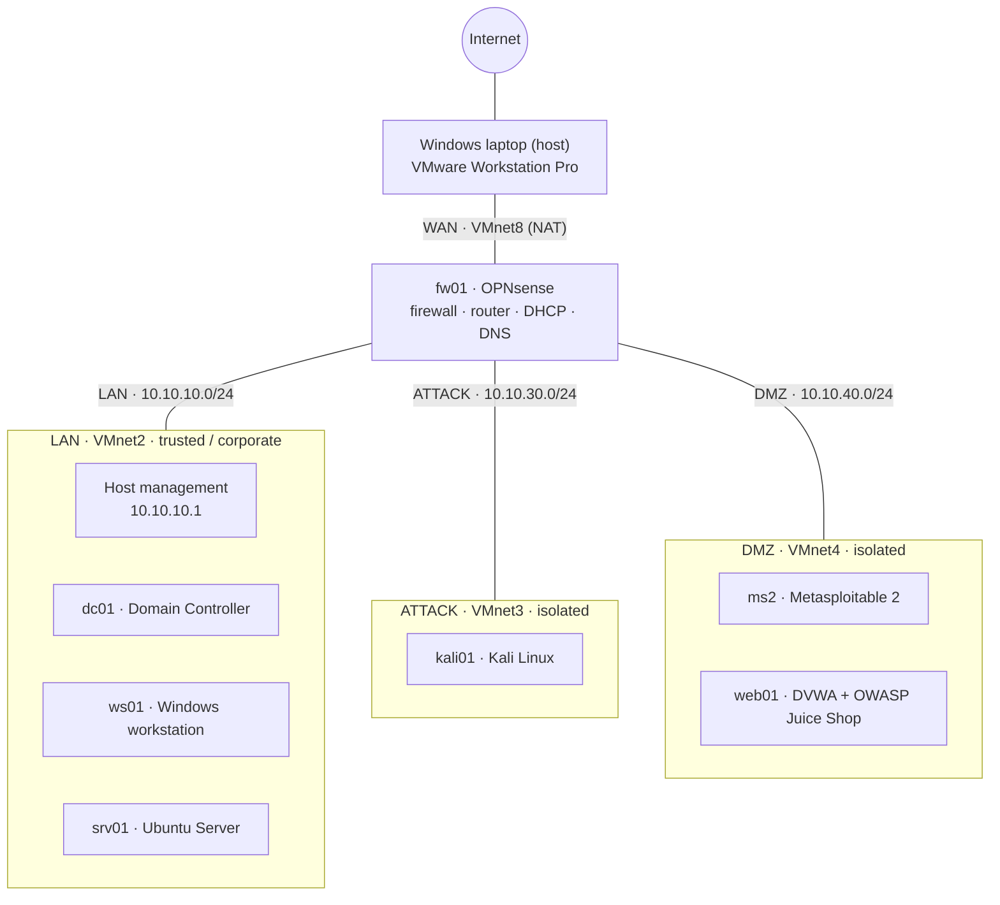

# 🛡️ Cybersecurity Home Lab

A segmented virtual lab I am building from scratch to practise network security, Active Directory administration, offensive techniques and vulnerability management, and later SOC monitoring, detection engineering and incident response. Every phase is documented with what I built, what broke, how I fixed it, and what I learned.


---

## Contents

- [Goals](#goals)
- [Architecture](#architecture)
- [Network plan](#network-plan)
- [Firewall policy](#firewall-policy)
- [Virtual machines](#virtual-machines)
- [Host hardware](#host-hardware)
- [Roadmap](#roadmap)
- [Repository structure](#repository-structure)
- [Skills demonstrated](#skills-demonstrated)
- [Lab journal](#lab-journal)
- [Safety and ethics](#safety-and-ethics)
- [References](#references)
- [About me](#about-me)

---

## Goals

- Build and secure a realistic small-company network with segmentation, a firewall, DHCP and DNS.
- Run a Windows Active Directory domain the way a real organization would, including realistic misconfigurations.
- Practise attacks **only inside the lab**, then learn to detect and respond to them.
- Map hands-on work to CompTIA Security+ objectives and the MITRE ATT&CK framework.
- Document everything so the lab can be rebuilt from this repository.

---

## Architecture



---

## Network plan

| Network | VMware network | Subnet | Gateway (fw01) | DHCP range | Purpose |
|---|---|---|---|---|---|
| WAN | VMnet8 (NAT) | assigned by VMware | assigned by VMware | VMware DHCP | Internet access through the host |
| LAN | VMnet2 (host-only) | 10.10.10.0/24 | 10.10.10.254 | .100 – .200 | Trusted corporate network and lab management |
| ATTACK | VMnet3 (host-only, no host adapter) | 10.10.30.0/24 | 10.10.30.254 | .100 – .200 | Attacker machine |
| DMZ | VMnet4 (host-only, no host adapter) | 10.10.40.0/24 | 10.10.40.254 | .100 – .200 | Intentionally vulnerable targets |

**Design notes**

- The host laptop has an adapter **only** on the LAN (10.10.10.1) so it can reach the firewall's web interface. ATTACK and DMZ have no path to the host.
- VMware's built-in DHCP is disabled on VMnet2–4 so that fw01 is the only DHCP server.
- Internal DNS domain: `lab.internal` (`.internal` is reserved for private use and will never exist on the public internet). The AD domain in Phase 2 will be `corp.lab.internal`.

---

## Firewall policy

Rules are evaluated top to bottom and the first match wins. Anything not explicitly allowed is blocked. The firewall is stateful, so replies to allowed connections are let back in automatically.

**Alias:** `RFC1918` = 10.0.0.0/8, 172.16.0.0/12, 192.168.0.0/16 (all private address space, including my real home and campus networks).

### ATTACK interface

| # | Action | Source | Destination | Port | Why |
|---|---|---|---|---|---|
| 1 | Pass | ATTACK net | ATTACK address | 53 (TCP/UDP) | DNS from the firewall |
| 2 | Pass | ATTACK net | DMZ net | any | Attacker may reach the targets |
| 3 | Block + log | ATTACK net | This Firewall | any | Attacker can't touch the firewall itself |
| 4 | Block + log | ATTACK net | RFC1918 | any | No access to LAN or to my real networks |
| 5 | Pass | ATTACK net | any | any | Internet for updates and tools |

### DMZ interface

| # | Action | Source | Destination | Port | Why |
|---|---|---|---|---|---|
| 1 | Pass | DMZ net | DMZ address | 53 (TCP/UDP) | DNS from the firewall |
| 2 | Block + log | DMZ net | This Firewall | any | Targets can't touch the firewall |
| 3 | Block + log | DMZ net | RFC1918 | any | Compromised targets can't pivot anywhere |
| 4 | Pass | DMZ net | any | any | **Temporary**, for initial setup downloads; to be disabled once targets are built |

### LAN interface

Default "allow LAN to any" rules. The LAN is the trusted network in this design. This will be tightened in later phases.

---

## Virtual machines

| Hostname | Role | OS | Network | IP | vCPU | RAM | Phase | Status |
|---|---|---|---|---|---|---|---|---|
| fw01 | Firewall, router, DHCP, DNS | OPNsense | WAN, LAN, ATTACK, DMZ | .254 on each internal network | 2 | 2 GB | 1 | ⏳ |
| kali01 | Attacker | Kali Linux | ATTACK | DHCP | 2 | 2–4 GB | 1 | ⏳ |
| dc01 | Domain controller (AD DS, DNS) | Windows Server (Evaluation) | LAN | 10.10.10.10 | 2 | 4 GB | 2 | 🔜 |
| ws01 | Domain-joined workstation | Windows 11 Enterprise (Evaluation) | LAN | DHCP | 2 | 4 GB | 2 | 🔜 |
| srv01 | Linux server | Ubuntu Server LTS | LAN | 10.10.10.20 | 1 | 2 GB | 2 | 🔜 |
| ms2 | Vulnerable target | Metasploitable 2 | DMZ | 10.10.40.10 | 1 | 1 GB | 3 | 🔜 |
| web01 | Vulnerable web apps | Ubuntu Server + Docker (DVWA, Juice Shop) | DMZ | 10.10.40.20 | 1 | 2 GB | 3 | 🔜 |

✅ done · ⏳ in progress · 🔜 planned

---

## Host hardware

| Component | Spec |
|---|---|
| Laptop | HP Pavillion 15 |
| CPU | AMD Ryzen 7 4800H |
| RAM | 16GB |
| Free storage for lab | 200GB |
| Host OS | Windows |
| Hypervisor | VMware Workstation Pro |

---

## Roadmap

### Phase 0: Setup
- [ ] Hardware check (RAM, CPU virtualization enabled, disk space)
- [ ] VMware Workstation Pro installed
- [ ] ISOs and images downloaded, SHA-256 checksums verified
- [ ] GitHub repository created

### Phase 1: Network foundation
- [ ] VMware virtual networks VMnet2 / VMnet3 / VMnet4 created
- [ ] OPNsense installed, initial wizard completed, firmware updated
- [ ] LAN, ATTACK and DMZ interfaces configured with DHCP
- [ ] Firewall aliases and rules configured, with logging on block rules
- [ ] Kali connected to ATTACK, segmentation tested and evidenced
- [ ] Phase 1 write-up published

### Phase 2: Active Directory
- [ ] dc01 installed and promoted, domain `corp.lab.internal`
- [ ] OUs, users, groups and Group Policies created
- [ ] ws01 joined to the domain
- [ ] srv01 Ubuntu server deployed
- [ ] Deliberate misconfigurations created and documented
- [ ] Phase 2 write-up published

### Phase 3: Attack surface and vulnerability management
- [ ] Metasploitable 2, DVWA and Juice Shop deployed in the DMZ
- [ ] Network discovery with Nmap, traffic analysis with Wireshark
- [ ] Vulnerability scan with Greenbone/OpenVAS or Nessus Essentials
- [ ] Vulnerability report, remediation, rescan
- [ ] DMZ internet access disabled after setup
- [ ] Phase 3 write-up published

### Coming next: SOC lab
- Phase 4: Telemetry (Sysmon, Windows audit policy, Suricata, Zeek)
- Phase 5: SIEM (Elastic Security)
- Phase 6: Detection engineering (Atomic Red Team, Sigma rules, MITRE ATT&CK mapping)
- Phase 7: Incident response (case management, SOAR, incident reports)
- Phase 8: Specialization

---

## Repository structure

```
cybersecurity-homelab/
├── README.md                    ← you are here
├── diagrams/
├── 01-network-foundation/
│   ├── README.md                ← phase write-up
│   └── screenshots/
├── 02-active-directory/
├── 03-attack-and-vuln-mgmt/
├── 04-telemetry/
├── 05-siem/
├── 06-detection-engineering/
│   └── sigma-rules/
├── 07-incident-response/
│   └── reports/
└── 08-specialization/
```

Each phase write-up follows the same template: **Objective → Architecture → What I built → Evidence → Problems I hit and how I fixed them → Security+ / MITRE ATT&CK mapping → What I'd do differently.**

---

## Skills demonstrated

| Security+ (SY0-701) domain | Where it shows up in this lab |
|---|---|
| 1. General Security Concepts | Least privilege firewall policy, integrity checks (SHA-256) on every download |
| 2. Threats, Vulnerabilities & Mitigations | Vulnerable targets, scanning, remediation (Phase 3), AD misconfigurations (Phase 2) |
| 3. Security Architecture | Network segmentation, DMZ design, isolated attack network (Phase 1) |
| 4. Security Operations | Firewall logging, patching, hardening, later SIEM and detection (Phases 4–7) |
| 5. Security Program Management & Oversight | Documentation, change log, rules of engagement (this README) |

---

## Lab journal

| Date | Phase | What I did | Problem and fix |
|---|---|---|---|
| YYYY-MM-DD | 0 | Created repository and README | n/a |

---

## Safety and ethics

- All offensive activity happens **only** inside isolated lab networks running on hardware I own.
- The ATTACK and DMZ networks are blocked by firewall policy from my real home and campus networks.
- No real credentials, personal data or employer data ever enter this lab or this repository.
- Configuration files are sanitized before they are committed. Full firewall backups stay offline.

---

## References

- OPNsense documentation: https://docs.opnsense.org
- Kali Linux documentation: https://www.kali.org/docs/
- MITRE ATT&CK: https://attack.mitre.org
- CompTIA Security+ exam objectives: https://www.comptia.org/certifications/security

---

## About me

**Jenilkumar Panchal**, MITS (AI specialization) student at Ontario Tech University, focused on SOC operations and security engineering.

[LinkedIn](https://www.linkedin.com/in/jenil-panchal) · jenilpanchal37@gmail.com